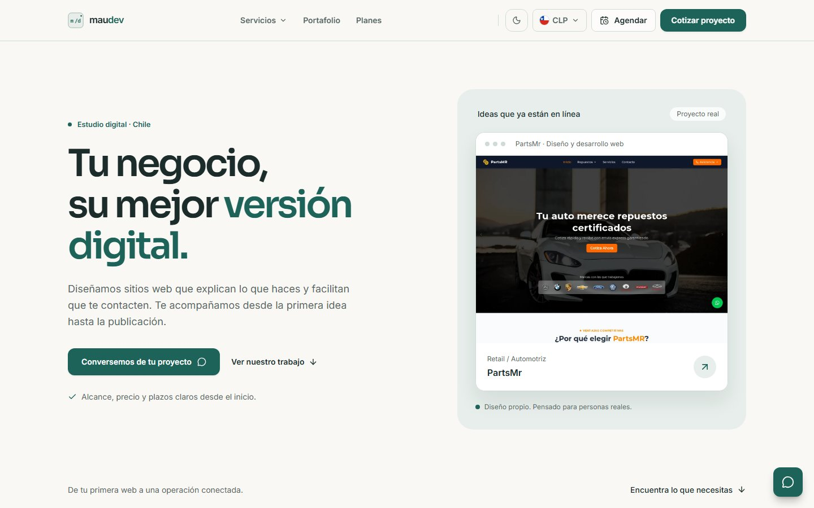

# Feature: reconstrucción de la experiencia visual

La portada exigía leer y decidir demasiado al mismo tiempo: un titular de gran tamaño, un cotizador, varias acciones, efectos de fondo y secciones de servicios repetidas. Esta propuesta organiza el recorrido alrededor de tres preguntas: qué hace Maudev, qué ha construido y cómo empezar.

## Dirección visual

Marfil como fondo, petróleo para las acciones y salvia para agrupar contenido. Superficies opacas, bordes suaves y sombras discretas. Los titulares mantienen Sora con una escala más contenida; Inter sigue siendo la fuente de lectura. No se agregan fuentes ni dependencias.

| Uso | Tema claro | Tema oscuro |
| --- | --- | --- |
| Fondo | `hsl(42 33% 97%)` | `hsl(174 22% 9%)` |
| Texto | `hsl(174 24% 14%)` | `hsl(40 26% 96%)` |
| Acción principal | `hsl(172 55% 25%)` | `hsl(160 40% 70%)` |
| Superficie secundaria | `hsl(150 17% 92%)` | `hsl(174 15% 16%)` |

Los bloques con fondo oscuro tienen su propio acento claro para mantener legibilidad también cuando el visitante usa el tema claro. La paleta y los componentes compartidos se aplican a las páginas internas, servicios, contacto y versiones en inglés y portugués.

## Recorrido y funcionalidades

| Área | Nueva presentación | Acceso conservado |
| --- | --- | --- |
| Inicio | Mensaje breve y captura de un proyecto real | WhatsApp y enlace al trabajo publicado |
| Navegación | Barra estable con Servicios, Portafolio y Planes | Catálogo, contacto, agenda, tema y moneda; menú móvil |
| Servicios | Tres opciones principales y catálogo ampliado desplegable | Web, mantención, automatización, software, apps y diseño |
| Proyectos | Dos destacados con capturas grandes | Casos de estudio, sitios externos y portafolio completo en `/casos` |
| Planes | Precio y resumen primero; inclusiones bajo demanda | Tres niveles, filtros y modales con todos los subservicios |
| Cotizador | Desplegable junto a los planes | Tipo, tamaño, precio estimado, plazo, moneda y enlace con parámetros a contacto |
| Proceso y preguntas | Etapas sencillas y respuestas desplegables | Entregables, condiciones y todas las preguntas existentes |
| Contacto | Texto directo y formulario con etiquetas | Validación, Turnstile, atribución y envío existentes |
| Ayuda | Apertura manual, sin simulación de escritura | Saludo por origen, agenda, automatizaciones, portafolio y WhatsApp |
| Pie de página | Familias de servicios desplegables | Todos los enlaces del catálogo, empresa, legales y cookies |

No se cambian rutas, datos de precios, integraciones, checkout, consentimiento ni configuración de despliegue. Se retiran adornos y repeticiones de la portada. La apertura automática del panel de ayuda se sustituye por una apertura explícita.

## Capturas



- [Página completa, tema claro](redesign/light-1440.jpg)
- [Página completa, tema oscuro](redesign/dark-1440.jpg)
- [Móvil, tema claro](redesign/light-390.jpg)
- [Móvil, tema oscuro](redesign/dark-390.jpg)

Las capturas se guardan fuera de `public/` y no forman parte del despliegue.

## Validación

```sh
npm run lint
npm run build
npm test
npm run test:design
```

La suite existente comprueba 24 rutas, metadatos, enlaces internos, cinco anchos, menú móvil, formulario con envío simulado y CSP. La nueva suite comprueba diez combinaciones de tema y ancho (320, 390, 768, 1024 y 1440 px), cotizador, referencia en USD, persistencia del tema, modal de planes, catálogos desplegables y ayuda mediante teclado. Las pruebas no acreditan una auditoría completa de accesibilidad ni envían leads reales.

Para regenerar las capturas después de compilar:

```sh
npm run test:design -- --screenshots
```

## Revisión en GitHub

Rama: `feature/rediseno-experiencia-visual`. La propuesta se presenta como pull request de borrador hacia `develop`. El workflow actual solo despliega al recibir pushes en `main` o `develop`; publicar esta rama no despliega producción.
